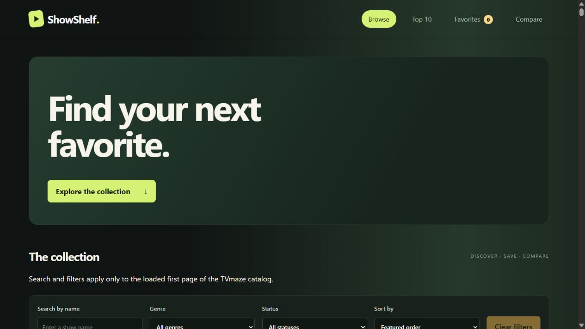
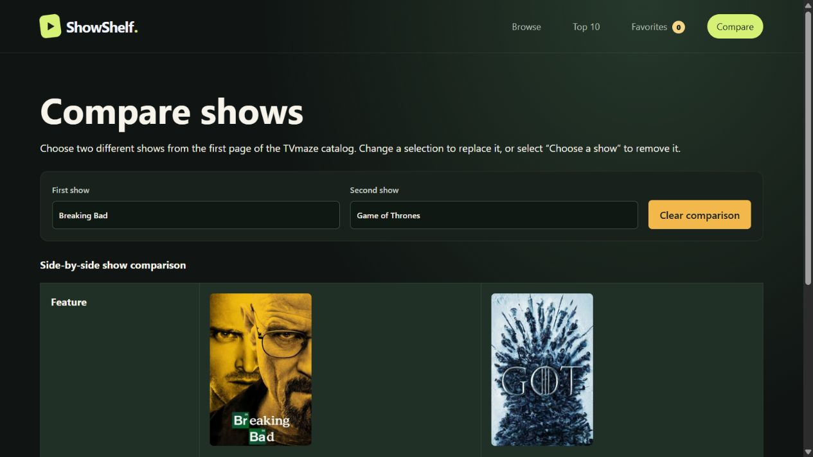
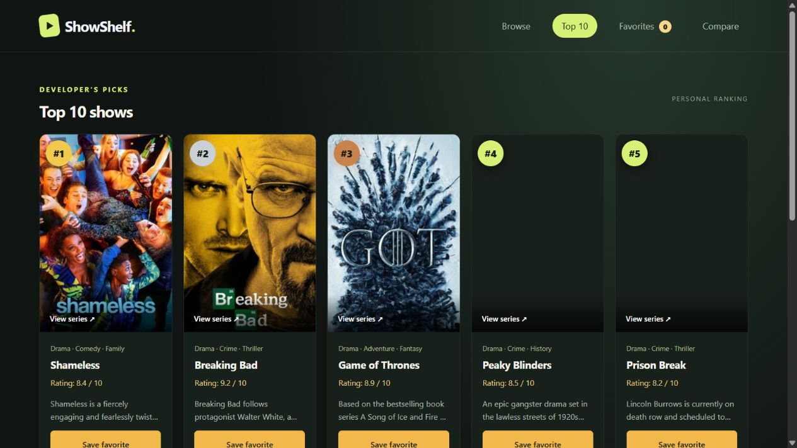

# ShowShelf

**A responsive TV discovery experience built with React and TypeScript.**

Browse the TVmaze catalog, find shows with combined filters, save favorites, compare two titles side by side, and explore a personal Top 10.




## Why I built it

ShowShelf turns a large TV catalog into a focused browsing experience. The project demonstrates API integration, typed React state, reusable components, client-side routing, local persistence, responsive design, and automated testing in a single front-end application.

## Highlights

- **Browse and discover** — search by name, filter by genre and status, and sort the loaded catalog.
- **Detailed show pages** — open a direct route for each show with its summary, rating, genres, schedule, and source link.
- **Persistent favorites** — save or remove shows and keep the selection across browser sessions with `localStorage`.
- **Side-by-side comparison** — search for two shows and compare ratings, genres, status, and schedule.
- **Personal Top 10** — a ranked collection with distinct podium styling for the first three places.
- **Resilient UI** — loading, empty, missing-image, invalid-route, API-error, and retry states.
- **Responsive and accessible** — keyboard-friendly controls, semantic labels, and layouts for desktop and narrow screens.

## Feature preview

| Compare shows | Personal Top 10 |
| --- | --- |
|  |  |

## Tech stack

| Area | Technology |
| --- | --- |
| UI | React, TypeScript, custom CSS |
| Tooling | Vite |
| Routing | React Router |
| Data | TVmaze REST API |
| Persistence | Browser `localStorage` |
| Testing | Vitest, Testing Library, jsdom |
| Code quality | TypeScript, Oxlint |

## How it works

```text
TVmaze API
    ↓ fetch inside useEffect
React page state
    ↓ typed props
Reusable components
    ↓
Rendered interface
```

`App.tsx` owns the shared favorites state and route configuration. Page components fetch or prepare their data, while reusable components such as `ShowCard`, `FavoriteButton`, `SearchFilters`, and `SearchableShowField` receive typed props and handle focused UI responsibilities.

## Routes

| Route | Page |
| --- | --- |
| `/` | Browse, search, filter, and sort shows |
| `/shows/:id` | Show details loaded by ID |
| `/favorites` | Saved shows and removal controls |
| `/compare` | Searchable two-show comparison |
| `/top-ten` | Personal ranked collection |
| `*` | Friendly not-found page |

## Run locally

### Requirements

- A current Node.js LTS release
- npm

```bash
git clone https://github.com/asaf0505-svg/showshelf.git
cd showshelf
npm ci
npm run dev
```

Open the local URL printed by Vite.

## Available commands

| Command | Purpose |
| --- | --- |
| `npm run dev` | Start the development server |
| `npm run build` | Type-check and create a production build |
| `npm run preview` | Preview the production build locally |
| `npm test` | Run the test suite once |
| `npm run test:ui` | Open the Vitest visual test interface |
| `npm run lint` | Run the linter |

## Testing

The project includes **50 tests across 8 files**. They cover filtering and sorting, favorites, comparison search, API processing, loading states, Top 10 ranking, and user interactions. API calls are mocked in component tests so the behavior can be tested predictably.

```bash
npm test
```

## Project structure

```text
src/
├── components/   Reusable UI components
├── data/         Top 10 configuration
├── pages/        Route-level page components
├── types/        TypeScript API and prop types
├── utils/        Filtering, favorites, and data helpers
├── App.tsx       Shared state and application routes
└── main.tsx      React entry point and BrowserRouter
```

## API and data

Show data comes from the public [TVmaze API](https://www.tvmaze.com/api). No API key, backend, account, or database is required. The browsing and comparison views use the first loaded catalog page; detail pages request the selected show directly by ID.

Favorites are stored locally in the current browser under `showshelf-favorites`. Missing data and images use safe fallbacks, and show summaries are converted to plain text before display.

## Documentation

- [Architecture and data flow](docs/architecture.md)
- [Verification record](docs/verification.md)
- [Product requirements](PRD.md)
- [Development task sequence](tasks.md)

Show information is provided by [TVmaze](https://www.tvmaze.com/) under [CC BY-SA](https://creativecommons.org/licenses/by-sa/4.0/).
